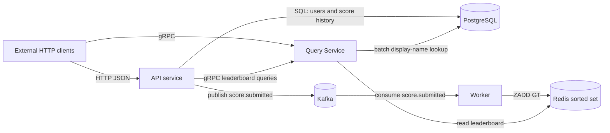

# Real-Time Leaderboard

[](https://github.com/SudiptoKumarMitra/real-time-leaderboard/actions/workflows/ci.yml)

A Go service that accepts authenticated score submissions, keeps their history in PostgreSQL, and asynchronously maintains a fast leaderboard projection in Redis through Kafka. The HTTP API, gRPC Query Service, and Kafka Worker are separate processes.

## Key features

- User registration and login with bcrypt password hashes and signed HS256 JWTs (24-hour expiry).
- Per-user score history in PostgreSQL; each accepted submission creates a row.
- Kafka-based asynchronous projection updates with a consumer group and retry/commit handling.
- Redis sorted-set leaderboard retaining each user's best score.
- gRPC leaderboard reads with a PostgreSQL fallback for the HTTP top leaderboard.
- Graceful shutdown and container/Kubernetes health checks.

## Technology stack

Go (see `go.mod`), PostgreSQL 17, Apache Kafka 4.3.1, Redis 7, HTTP/JSON, Protocol Buffers and gRPC, Docker Compose, Kubernetes/Kustomize, and Kind. Kafka uses KRaft in Compose.

## System architecture



The API owns HTTP registration, login, score submission, and leaderboard endpoints. The Query Service serves read-only gRPC calls. The Worker consumes Kafka events and writes the Redis projection. PostgreSQL is the durable user and score-history store; Redis is derived leaderboard state. The Query Service also exposes gRPC health and reflection. The service-to-service gRPC connection is plaintext in the current configuration.

## Score submission data flow

```mermaid
sequenceDiagram
    autonumber
    actor Client as External client
    participant API as API service
    participant PG as PostgreSQL
    participant Kafka
    participant Worker
    participant Redis
    Client->>API: POST /scores + Bearer JWT + score
    API->>API: Validate JWT and score (0..1,000,000)
    API->>PG: Insert score; return id and created_at
    PG-->>API: Persisted score row
    API->>Kafka: Publish score.submitted (key=user_id)
    alt Kafka publish succeeds
        Kafka-->>API: Acknowledgment
    else Kafka publish fails after retries/timeout
        API-->>Client: Still returns 201; log warning
    end
    API-->>Client: 201 {status, score_id, score}
    Kafka->>Worker: Deliver event in leaderboard-writer group
    Worker->>Redis: ZADD leaderboard GT score user_id
    Redis-->>Worker: Update result
    Worker->>Kafka: Commit offset after processing
```

## Leaderboard read flow

`GET /leaderboard` asks the API's gRPC client for top entries. The Query Service reads Redis and resolves display names from PostgreSQL in one batch query. If that call fails or returns no entries, the API computes top best scores from PostgreSQL and resolves names there. Ranks are 1-based in HTTP responses. `GET /leaderboard/{userID}/rank` reads Redis through gRPC; it does not use the PostgreSQL fallback. An unranked user is a normal `200` response.

## Database design

`db/schema.sql` defines:

- `users`: serial primary key, name, unique email, bcrypt password hash, and created/updated timestamps.
- `scores`: serial primary key, `user_id` foreign key with `ON DELETE CASCADE`, integer score, and creation timestamp. Repeated and zero scores are permitted; each submission is retained.
- Indexes on `scores(user_id)` and `(user_id, score DESC)`.

The leaderboard fallback groups score history by user, selects `MAX(score)`, sorts descending, and applies the requested limit. Compose mounts this SQL as a PostgreSQL initialization script; it runs only for an empty data directory.

## Kafka event processing and consumer behavior

The API publishes JSON to the infrastructure-created `score.submitted` topic. Event fields are `event`, `user_id`, `score`, `score_id`, and `created_at`; the latter two come from the inserted PostgreSQL row. The Kafka message key is the user ID, so that user's events hash to the same partition. Compose and the Kind topic job configure two partitions and replication factor one.

The `leaderboard-writer` consumer group processes a message, updates Redis, then commits its offset synchronously. Redis failures retry the same message with capped exponential backoff and leave it uncommitted. Malformed JSON or invalid user/negative score events are logged and committed as skipped events. Offset commit failures are retried up to five times; if still unsuccessful, the consumer stops so later offsets cannot implicitly commit the unresolved message. Re-delivery is safe because the Redis update only raises a user's score. This is at-least-once processing; there is no transactional outbox between PostgreSQL and Kafka.

## Redis leaderboard design

The key `leaderboard` is a sorted set with `user_id` strings as members and each user's best score as the sorted-set score. `ZADD ... GT` adds new users and only replaces existing scores when the new score is greater, making duplicate/replayed events convergent. Top entries use descending range reads; rank uses descending rank lookup. Redis stores derived state and can be recomputed from PostgreSQL score history, though the repository does not provide a dedicated rebuild command.

## gRPC Query Service

`proto/leaderboard/v1/leaderboard.proto` defines `leaderboard.v1.LeaderboardQuery`:

- `GetLeaderboard(limit)` returns descending entries with 1-based ranks, user IDs, scores, and PostgreSQL display names; limit must be 1–100.
- `GetUserRank(user_id)` returns `ranked=false` for a user absent from the projection, otherwise a 1-based rank and best score.

Redis and name lookup failures return gRPC `Internal`; invalid arguments return `InvalidArgument`. The server also registers standard gRPC health and reflection. The HTTP API's gRPC client uses a 2-second per-RPC deadline and connects lazily. Its default target is `localhost:50051`, configurable with `QUERY_ADDR`; the server address is `QUERY_GRPC_ADDR` (default `localhost:50051`).

## HTTP API

All error examples below are plain text response bodies from `http.Error` (with a trailing newline). Routes accept only the listed method; other methods receive `405 method not allowed`. Public means no JWT is checked.

### `GET /health` — public

Success (`200`):

```json
{"status":"ok"}
```

Other errors: `405 method not allowed`.

### `POST /register` — public

Request:

```json
{"name":"Ada Lovelace","email":"ada@example.com","password":"correct-horse-battery"}
```

Success (`201`):

```json
{"user_id":1,"status":"ok","message":"user registered successfully"}
```

Errors: `400 invalid request body`; `400 name, email, and password are required`; `400` for service input validation; `409 duplicate email`; `500 internal server error`.

### `POST /login` — public

Request:

```json
{"email":"ada@example.com","password":"correct-horse-battery"}
```

Success (`200`; token value abbreviated):

```json
{"user_id":1,"status":"ok","message":"user logged in successfully","token":"<signed-jwt>"}
```

Errors: `400 invalid request body`; `400 email and password are required`; `400` for service input validation; `401 invalid credentials`; `500 internal server error`.

### `POST /scores` — JWT required

Send `Authorization: Bearer <token>` from `/login`. The user ID comes from the verified JWT; a `user_id` in the body is ignored.

Request:

```json
{"score":812347}
```

Success (`201`):

```json
{"status":"ok","score_id":42,"score":812347}
```

Errors: `401 missing token`, `401 invalid token format`, `401 token expired`, or `401 invalid token` (including invalid claims); `400 invalid request body`; `400 score is required`; `400 score must be an integer between 0 and 1000000`; `500 internal server error` if PostgreSQL insert fails. Kafka publish failure is logged but does not change the successful response.

### `GET /leaderboard?limit=N` — public

`limit` is optional (default `10`); accepted values are integers from 1 to 100.

Success (`200`):

```json
{"leaderboard":[{"rank":1,"user_id":1,"name":"Ada Lovelace","score":812347}]}
```

An empty board is `{"leaderboard":[]}`. Errors: `400 limit must be an integer between 1 and 100`; `500 internal server error` if both projection read and PostgreSQL fallback/name lookup fail.

### `GET /leaderboard/{userID}/rank` — public

`userID` must be a positive integer.

Ranked success (`200`):

```json
{"user_id":1,"ranked":true,"rank":1,"best_score":812347}
```

Unranked success (`200`):

```json
{"user_id":9,"ranked":false,"message":"user is not currently ranked"}
```

Errors: `400 invalid user id`; `500 internal server error` if the Query Service/Redis rank lookup fails. Unlike the top leaderboard endpoint, rank has no PostgreSQL fallback.

## Local development with Docker Compose

Prerequisites: Docker Engine or Docker Desktop, Docker Compose v2+, and `curl`; `grpcurl` is optional.

1. Create `.env` from the placeholder file and replace the PostgreSQL, Redis, and JWT credentials with local values. Do not commit `.env`.

   ```sh
   cp .env.example .env
   ```

2. Build and start the services:

   ```sh
   docker compose build api query-service worker
   docker compose up -d
   docker compose ps
   ```

3. Check the API and (optionally) gRPC health:

   ```sh
   curl -fsS http://localhost:8080/health
   grpcurl -plaintext localhost:50053 grpc.health.v1.Health/Check
   ```

Compose publishes API `8080`, Query gRPC `50053`, PostgreSQL `5432`, Redis `6379`, and Kafka `9092` on loopback by default; host ports are configurable in `.env`. Containers use service DNS (`postgres`, `redis`, `kafka:29092`, `query-service:50051`). `kafka-init` creates/verifies the two-partition topic before API and Worker start. PostgreSQL, Redis, and Kafka use named volumes. `docker compose down` retains them; avoid `-v` to preserve data.

## Kubernetes deployment with Kind

The Kustomize overlays under `k8s/overlays/kind` target an existing `kind-leaderboard` context and namespace `leaderboard`. Build and load the three `:dev` images before deployment; manifests use `IfNotPresent` and do not build images. Ensure `.env` exists with the five required values (`POSTGRES_USER`, `POSTGRES_PASSWORD`, `POSTGRES_DB`, `REDIS_PASSWORD`, `JWT_SECRET`).

```sh
docker compose build api query-service worker
kind load docker-image leaderboard-api:dev leaderboard-query:dev leaderboard-worker:dev --name leaderboard
```

Create namespace, then create the Secret from `.env` without printing its values:

```sh
kubectl apply --context kind-leaderboard -f k8s/base/infra/namespace.yaml
secret_env="$(mktemp)"
chmod 600 "$secret_env"
trap 'rm -f "$secret_env"' EXIT
grep -E '^(POSTGRES_USER|POSTGRES_PASSWORD|POSTGRES_DB|REDIS_PASSWORD|JWT_SECRET)=' .env > "$secret_env"
test "$(wc -l < "$secret_env")" -eq 5
kubectl create secret generic leaderboard-secrets --context kind-leaderboard --namespace leaderboard --from-env-file="$secret_env" --dry-run=client -o yaml | kubectl apply --context kind-leaderboard -f -
```

Deploy in dependency order (Kubernetes does not provide Compose `depends_on`):

```sh
kubectl apply --context kind-leaderboard -k k8s/overlays/kind/infra
kubectl --context kind-leaderboard -n leaderboard rollout status statefulset/postgres --timeout=5m
kubectl --context kind-leaderboard -n leaderboard rollout status statefulset/redis --timeout=5m
kubectl --context kind-leaderboard -n leaderboard rollout status statefulset/kafka --timeout=8m
kubectl apply --context kind-leaderboard -k k8s/overlays/kind/topic
kubectl --context kind-leaderboard -n leaderboard wait --for=condition=complete job/kafka-topic-init --timeout=5m
kubectl apply --context kind-leaderboard -k k8s/overlays/kind/query
kubectl --context kind-leaderboard -n leaderboard rollout status deployment/query-service --timeout=5m
kubectl apply --context kind-leaderboard -k k8s/overlays/kind/apps
kubectl --context kind-leaderboard -n leaderboard rollout status deployment/api --timeout=5m
kubectl --context kind-leaderboard -n leaderboard rollout status deployment/worker --timeout=5m
```

Forward the API locally with `kubectl --context kind-leaderboard -n leaderboard port-forward service/api 18080:8080`. The infrastructure manifests request local persistent volumes (PostgreSQL 5 Gi, Redis 2 Gi, Kafka 8 Gi); this single-node Kind setup is for development, not HA. Kubernetes storage is separate from Compose volumes.

## CI workflow

`.github/workflows/ci.yml` runs on pushes and pull requests targeting `main` or `feature/**`, and supports manual dispatch. It uses the Go version in `go.mod`; runs tests (including race detection), build, and vet; validates Compose with `.env.example`; builds the API, Query Service, and Worker Docker targets without publishing; and renders Kustomize manifests. It does not deploy or publish releases.

## Design decisions and trade-offs

- PostgreSQL is the durable source of truth; Redis is a disposable, low-latency projection.
- Persist-before-publish avoids emitting an event for a failed database write, while best-effort publishing avoids turning a durable score into an HTTP failure. Without an outbox, a broker outage can leave the projection stale until another repair/rebuild mechanism is used.
- Kafka partition keys preserve per-user event order; at-least-once consumption plus monotonic max-score updates makes duplicate delivery safe.
- The Query Service separates Redis reads from HTTP concerns and batches display-name lookup. Top leaderboard reads can fall back to PostgreSQL, while individual rank reads depend on Query Service availability.
- A single-node broker, replication factor one, plaintext local traffic, and Kind local-path storage favor simple local development over production availability/security.

## Current limitations

- No transactional outbox or automated projection rebuild command; failed score-event publication can leave Redis behind PostgreSQL.
- `GET /leaderboard/{userID}/rank` returns `500` while Query Service/Redis is unavailable; only top leaderboard reads have a PostgreSQL fallback.
- The consumer skips malformed/invalid events after logging; skipped events require external correction/replay if their data matters.
- Compose and the documented Kind deployment are single-instance development setups without broker replication, TLS, or highly available storage.
- Registration/login use basic required-field checks; no rate limiting or email verification is implemented.
